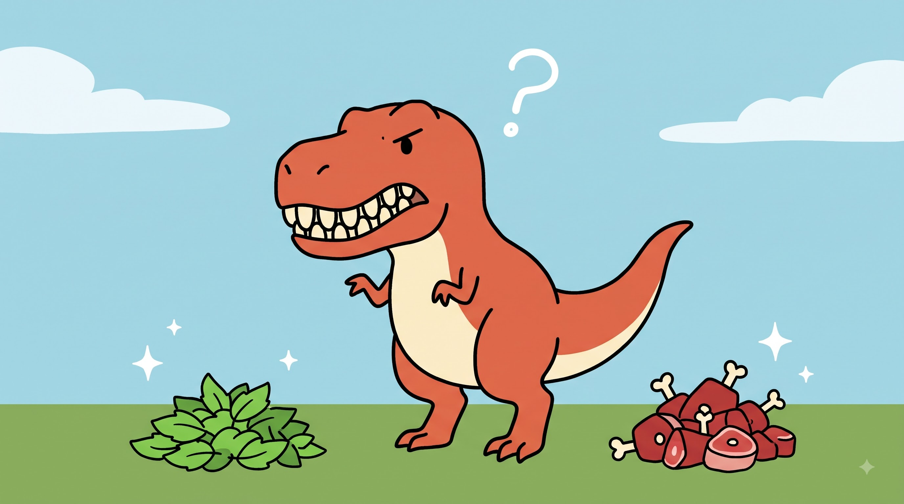
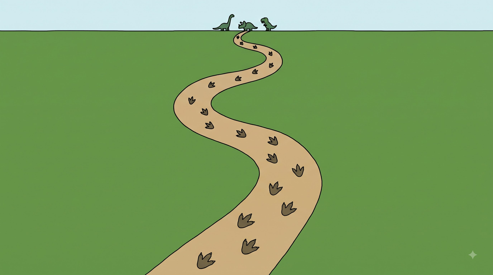
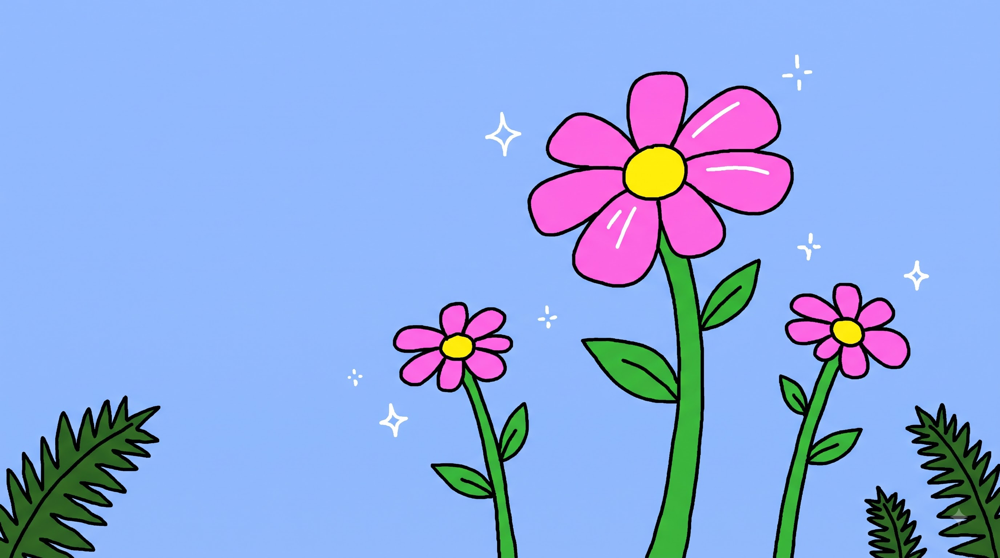

# mspaint-video-prompts

A Claude skill that turns a topic (or your own script) into a complete set of image prompts for **faceless YouTube slideshow videos** in a flat, crude, **MS Paint-style cartoon look**: thick wobbly outlines, solid colors, one simple image every few seconds, with a voiceover on top.

Claude writes the narrator script, you record the voiceover, you send back timestamps, and Claude designs **every image** (camera angle, scene, character positions, doodles) and delivers copy-paste prompts in a `.txt` file for Google Flow, Midjourney, DALL-E or any other image generator.

> **Important:** Claude does not generate images. This skill produces the *prompts*. You paste them into an image tool of your choice.

---

## What it does

- **Asks you first with a poll** (tappable options), so you don't have to type answers: script source, narration language, video length.
- **Writes the script** from your topic, or uses yours as-is if you already have one.
- **Maps your timestamps to images.** Short lines get short images, long lines can be split into two.
- **Designs each image deliberately**: camera angle (with a stated reason), scene design, position of every subject in the frame, and small hand-drawn doodles.
- **Keeps the look consistent** across 40-60+ images with a fixed master style block and fixed character descriptions repeated word for word.
- **Delivers full-length prompts** in a plain `.txt` file, written in batches of about 10 so nothing gets shortened.

## Example Images

<p align="center">
  
  
  
</p>

## The workflow

```text
Topic  ->  Script  ->  Voiceover (e.g. ElevenLabs)  ->  Timestamps
                                                            |
Final video  <-  Edit (CapCut / DaVinci / Canva)  <-  Images  <-  Image prompts (.txt)
```

| Step | Who does it | What happens |
|---|---|---|
| 1. Poll | Claude | Asks script source, language and video length |
| 2. Script | Claude (or you) | One idea per line, written for voiceover |
| 3. Voiceover | You | Generate audio with a voice tool |
| 4. Timestamps | You | Send `0:00 - 0:04  line text` style timings |
| 5. Image plan | Claude | One image per line or group of lines |
| 6. Prompts | Claude | Full prompt per image, delivered as `.txt` |
| 7. Generate and edit | You | Make images, add voiceover and motion in your editor |

## Example prompt

For the narration line *"An octopus has three hearts, and its blue blood..."*, the skill produces a prompt like this:

```text
Flat 2D cartoon illustration in a crude hand-drawn MS Paint style. Thick, slightly wobbly black outlines, solid flat colors with no gradients, no shading, no texture, no realistic lighting. Simple shapes, minimal background. 16:9 widescreen.

SCENE: Underwater seabed. The background is a plain flat blue ocean, and the bottom 15% of the frame is a flat pale-yellow sand strip with a gently wavy top edge. Nothing else in the background.

SUBJECT: A cute purple octopus with a round head, light-purple suckers on its arms, and two small dot eyes with a calm, curious expression. The body has a thick black outline.

CAMERA: Eye-level medium shot, as if the viewer is sitting on the seabed looking straight at the octopus. Slight low angle so the octopus feels a bit big and friendly.

POSITION: The octopus sits in the center-right of the frame, taking up about 55% of the width. It faces left, toward the viewer. One arm curls up toward the center of the frame, holding a single red strawberry with a green leaf top. The strawberry is clearly visible and sits in the middle of the frame. The left third of the frame is empty blue water.

DOODLES: Three small white hand-drawn stars and two short white sparkle lines above the strawberry. No other decorations.

NO text, no letters, no watermark, no realistic style, no 3D look, no gradients.
```

Each entry in the output file also carries the timestamp, the narrator line, and a short note on why that camera angle was chosen, kept outside the copy area so pasting stays clean.

## Installation

### Option 1: Install with Claude Code CLI

**Requirements**
- Claude Code installed and working in your terminal.
- An internet connection.
- Access to the GitHub repository.

Run these commands **in your normal terminal, outside an active Claude Code session**:

```bash
claude plugin marketplace add NoWayShub/MS-Paint-Claude-Skill
claude plugin install mspaint-video-prompts@mspaint-skills
```

After installation, start or restart Claude Code.

The skill can activate automatically when you describe a relevant task, such as:

> Make an MS Paint-style faceless YouTube video about dinosaurs.

You can also invoke it directly with its namespaced skill command:

```text
/mspaint-video-prompts:mspaint-video-prompts
```

To check the available plugin commands, use:

```bash
claude plugin --help
```

To uninstall the plugin:

```bash
claude plugin uninstall mspaint-video-prompts@mspaint-skills
```

To remove the marketplace entry:

```bash
claude plugin marketplace remove mspaint-skills
```

If a command fails, check the marketplace name, plugin name and repository manifest before retrying. These names must match the published configuration.

### Option 2: Install through Claude Code Desktop

1. Open Claude Code Desktop.
2. Open **Customize** in the sidebar.
3. Find **Plugins**.
4. Look for **Add marketplace** or the equivalent marketplace option.
5. Add this GitHub repository:

   ```text
   NoWayShub/MS-Paint-Claude-Skill
   ```

6. Find and install the `mspaint-video-prompts` plugin.
7. Start a new session and try a relevant request.

The exact menu labels and available features can vary by application version, account plan and organization settings. If the marketplace option is unavailable, use the CLI installation method above.

### Option 3: Install the packaged skill manually

Use this option if you want to install the skill without installing the entire plugin marketplace.

1. Open this repository on GitHub.
2. Download the `mspaint-video-prompts.skill` file.
3. Open Claude and go to its skill customization or skills settings.
4. Use the available upload/import option to upload the `.skill` file.
5. Save or enable the skill if prompted.
6. Start a new chat and describe your video idea.

Manual skill upload is separate from plugin installation. The exact upload process depends on the Claude product you are using and the features available to your account.

### Which installation method should I use?

| Method | Best for |
|---|---|
| Claude Code CLI | Developers who want repeatable terminal commands |
| Claude Code Desktop | Users who prefer a graphical interface |
| Manual `.skill` upload | Users who only need the packaged skill |

## Usage

Start a new chat or Claude Code session and say what you want in your own words, for example:

> I want a faceless MS Paint-style video on what dinosaurs ate.

> Mere paas script hai, uske liye image prompts chahiye.

Claude will open a poll, then guide you through the steps above. When your voiceover is ready, send the timestamps:

```text
0:00 - 0:04  Line text
0:04 - 0:09  Line text
```

If you only know the total audio length, Claude can estimate timings from the word count, but it will tell you plainly that these are estimates. Real timestamps give a better match between voice and image.

## Repository structure

```text
.
├── .claude-plugin/
│   └── marketplace.json
├── plugin/
│   ├── .claude-plugin/
│   │   └── plugin.json
│   └── skills/
│       └── mspaint-video-prompts/
│           ├── SKILL.md
│           └── references/
│               ├── dinosaur.png
│               ├── footprints.png
│               ├── flowers.png
│               ├── style-and-prompt-template.md
│               ├── camera-guide.md
│               └── script-writing.md
├── mspaint-video-prompts.skill
├── README.md
└── LICENSE
```

## Languages

Narration can be in Hindi, Hinglish, English or another language. The image prompts are always written in English, because image models follow English prompts most reliably.

For Hindi narration, the skill writes in Devanagari by default, since voice tools generally pronounce it better than Roman letters. Test a short sample in your voice tool first.

## Known limitations

- **No image generation.** You need a separate image tool.
- **Character consistency is not guaranteed.** The skill repeats fixed character descriptions word for word, which helps, but image generators can still drift between images. Use whatever reference or consistency features your tool offers, and check the first few images before generating the rest.
- **Tool features vary and change.** The skill doesn't assume specific features of Google Flow or any other generator.
- **No readable text inside images.** Image models misspell text, so add titles and labels in your video editor.
- **Long prompts are not always followed fully.** Some generators weigh the start of a prompt more than the end. The skill puts style, subject, position and camera first for this reason.
- **Facts need your eyes too.** Claude tries to verify claims when search is available and marks uncertain ones as such, but you should check anything you plan to publish.
- **Tested lightly so far.** It has been tried on a small number of topics, including a dinosaur-diet video, and the octopus prompt above was confirmed to generate the intended look in Google Flow. Wider testing across other generators and topics hasn't been done, so results may vary.

## Contributing

Issues and pull requests are welcome. Useful contributions include:

- Prompt template tweaks that work better in a specific image generator (please mention which one and what changed)
- Fixes for character drift across many images
- Support for other visual styles (chalkboard, watercolor, etc.)
- Better handling of other languages

If you report a bad result, include the prompt, the generator you used, and what looked wrong. That makes it much easier to fix.

## License

This project is distributed under the license included in the repository. Check the `LICENSE` file for the exact terms.
